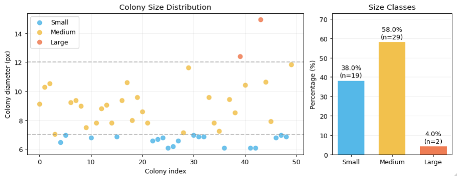

Colony Characterization
=======================

Colony characterization extends the exploratory analysis introduced in :doc:`single_image` by examining colony size and color without requiring a predefined ``Species``.

Analysis Overview
-----------------

The following examples use preliminary colonies stored in ``plate.candidates``. Load a single image, select the agar region and detect preliminary colonies as described in :doc:`single_image` before proceeding.

Colony Size Analysis
--------------------

Estimate colony diameters in pixels and group the measured colonies into size classes.

.. literalinclude:: examples/characterization_example.py
   :language: python
   :start-at: sizes = plate.candidates.measure_sizes(
   :end-at: size_counts = plate.candidates.classify_sizes(

``max_radius`` controls the size of the local measurement region. The parameters ``small_limit`` and ``large_limit`` define the diameter thresholds:

* Small: below 10 pixels.
* Medium: 10 to below 15 pixels.
* Large: at least 15 pixels.

Colony diameters are measured in pixels.

Colony Color Classification
---------------------------

Assign colonies to predefined color categories using fixed RGB thresholds and display a selected color group.

.. literalinclude:: examples/characterization_example.py
   :language: python
   :start-at: plate.candidates.classify_colors()
   :end-at: plate.candidates.get_by_color(

The available categories are ``white``, ``yellow``, ``green``, ``red``, ``blue`` and ``unknown``. Choose a category present in your results when using ``get_by_color()``.

Colony Color Clustering
-----------------------

Alternatively, group colonies with similar RGB values using DBSCAN without predefined color categories.

.. literalinclude:: examples/characterization_example.py
   :language: python
   :start-at: clusters = plate.candidates.cluster_candidates(
   :end-at: plate.candidates.plot_clusters(clusters)

* ``n_candidates=None`` includes all active colonies.
* ``eps`` controls how similar neighboring RGB values must be to form clusters.
* ``min_samples`` specifies the minimum number of neighboring samples, including the sample itself, required for a core point.

``return_details=True`` provides additional information, including candidate IDs and cluster labels. Label ``-1`` represents outliers.

Optional: Estimating Species Settings from a Cluster
~~~~~~~~~~~~~~~~~~~~~~~~~~~~~~~~~~~~~~~~~~~~~~~~~~~~

Select the candidate IDs of a suitable cluster to estimate species settings. The example uses cluster 0.

.. code-block:: python

   selected_ids = [candidate_id for candidate_id, label in
                   zip(clusters["candidate_ids"], clusters["labels"]) if label == 0]
   if selected_ids:
       species = plate.candidates.get_species(name="Example colonies", include=selected_ids)
       print(species)

Example Output
--------------

``classify_sizes()`` displays diameter measurements and size-class percentages. ``get_by_color()`` displays individual colonies from the selected color category. ``plot_clusters()`` shows the color clusters and outliers on the plate image.

Common Problems and Solutions
-----------------------------

* **No valid size measurements:** Adjust ``max_radius`` and check the contrast between colonies and their surroundings.
* **Unexpected color categories:** Check the illumination or use color clustering instead of fixed RGB thresholds.
* **Too many outliers or merged clusters:** Increase ``eps`` if too many outliers occur or decrease it if distinct clusters are merged. Adjust ``min_samples`` if necessary.
* **Results unavailable after changing the colony selection:** Repeat the characterization methods after excluding or restoring colonies.