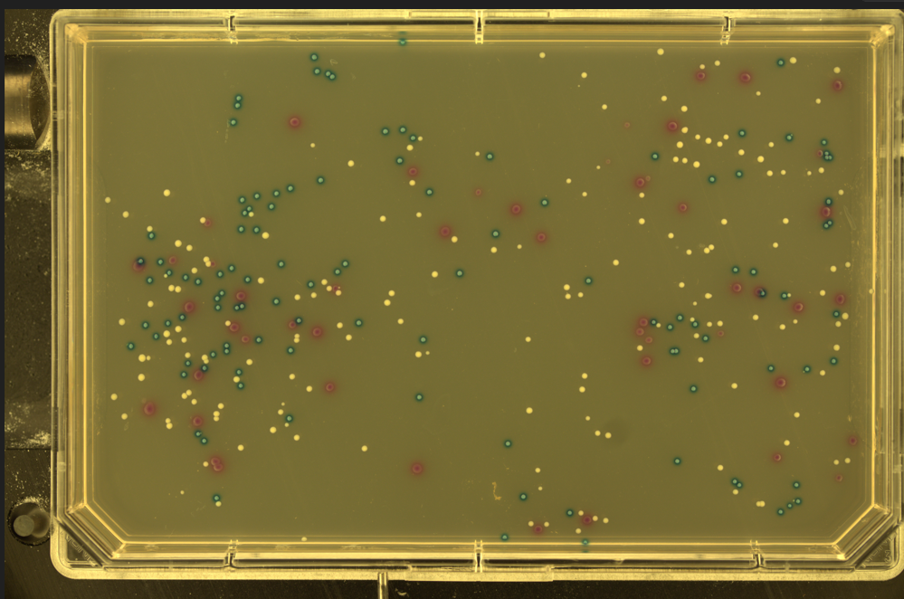
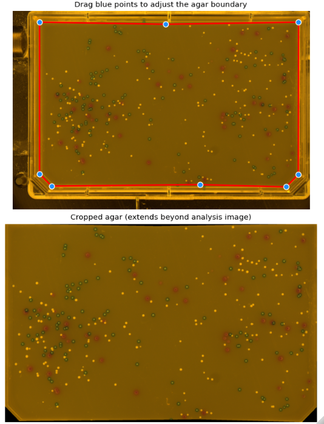
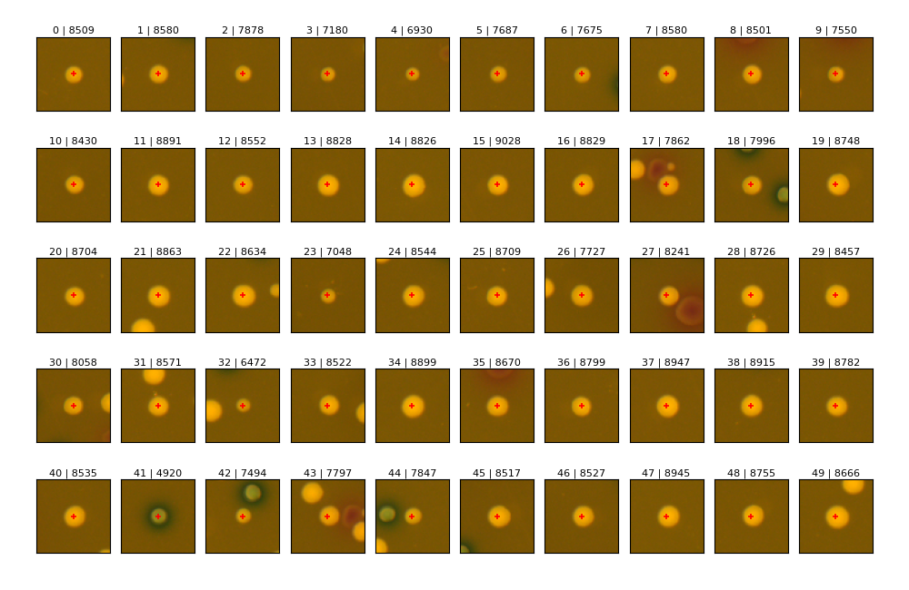
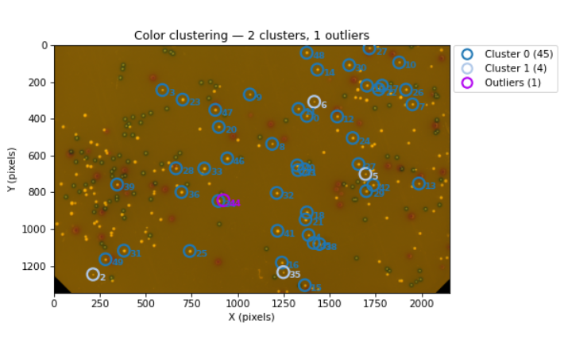
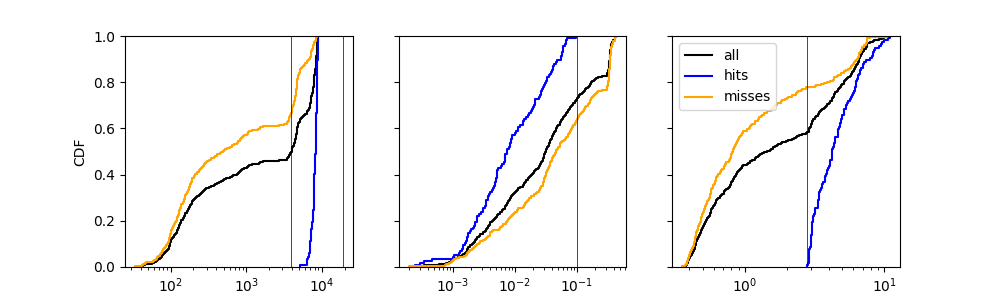

Single-Image Analysis
=====================

Colony Differentiation supports the analysis of individual agar plate images, including rectangular and circular plates.
The ``SingleImagePlate`` class supports RAW and PNG files as well as RGB images provided directly as NumPy arrays.
Both rectangular and circular agar regions can be selected before colony detection.

Analysis Overview
-----------------

The analysis begins with the detection and characterization of colonies without requiring a predefined species. If a particular colony type is of interest, species-based detection can be performed.

**Exploratory Colony Analysis** detects a preliminary list of colonies that can be inspected, measured, classified and clustered by color. These results can be used independently without a ``Species`` definition.

**Species-Based Colony Detection** detects colonies matching a ``Species`` definition. The detection settings can be estimated from selected preliminary colonies or defined manually. This is a separate detection, not a classification of the preliminary colony list.

Both approaches can be combined. If the species settings are already known, species-based detection can also be performed directly.

For further characterization options, see :doc:`characterization`.

Example: Rectangular Agar Plate
-------------------------------

The following example demonstrates exploratory colony analysis on a rectangular agar plate, followed by optional species-based detection.

Loading and Displaying the Image
~~~~~~~~~~~~~~~~~~~~~~~~~~~~~~~~

Enable interactive Matplotlib figures in a Jupyter notebook and display the original RAW image before selecting the agar region.
Replace the placeholder path with your own image path.

.. code-block:: python

   %matplotlib widget

   import sys
   sys.path.insert(0, "../colony_differentiation")
   from tools import *

   image_path = "path/to/your/image.CR2"

   with rawpy.imread(image_path) as raw:
       original_image = raw.postprocess()

   show(original_image)

Selecting the Agar Region
~~~~~~~~~~~~~~~~~~~~~~~~~

Initialize the plate and select the rectangular agar region interactively.

The agar boundary is detected automatically and can be adjusted manually by dragging the blue control points.
A preview of the cropped agar region is updated during the adjustment.

.. code-block:: python

   plate = SingleImagePlate(image_path, name="Rectangular plate")
   plate.crop_rectangular_plate(interactive=True)

Complete the adjustment before proceeding to colony detection.
Both detection methods use the resulting selection mask.

For fully automatic cropping without manual adjustment, use:

.. code-block:: python

   plate.crop_rectangular_plate(show_plot=True)

Optional: Area of Interest
~~~~~~~~~~~~~~~~~~~~~~~~~~

If only a specific region of the agar plate is of interest, a rectangular area of interest (AOI) can be selected interactively:

.. code-block:: python

   %matplotlib widget

   plate.select_rectangular_aoi()

Click and drag the mouse to select the desired region. Subsequent colony detection is restricted to the selected area of interest.

Exploratory Colony Analysis
~~~~~~~~~~~~~~~~~~~~~~~~~~~

Detect preliminary colonies within the selected agar region without specifying a species.
The detected colony positions are stored in ``plate.candidates`` and form the basis for further characterization.

.. literalinclude:: examples/single_image_example.py
   :language: python
   :start-at: plate.find_candidates(
   :end-at: plate.find_candidates(

Inspect the numbered colonies and exclude incorrect detections if necessary, for example with ``plate.candidates.exclude_candidates([0])``.

Measure colony diameters, classify sizes and cluster colonies by their RGB color:

.. literalinclude:: examples/single_image_example.py
   :language: python
   :start-at: plate.candidates.measure_sizes(
   :end-at: plate.candidates.plot_clusters()

The resulting size distributions, size classes and color clusters can be used independently to characterize the detected colonies.

Selected preliminary colonies can also be used to estimate species-specific detection settings.

Species-Based Colony Detection
~~~~~~~~~~~~~~~~~~~~~~~~~~~~~~~~~~~~~~~~~

To detect a particular colony type, define a ``Species`` using either of the following approaches.

**Option A: Estimate Species Settings**

By default, all active preliminary colonies are used to estimate species settings. To use only selected colonies, specify their IDs using ``include``, e.g. ``include=[0, 2]``.

.. literalinclude:: examples/single_image_example.py
   :language: python
   :start-at: species = plate.candidates.get_species(
   :end-at: print(species)

**Option B: Define Species Settings Manually**

Species settings can also be defined manually and adjusted to the characteristics of the target colonies.

The following settings are illustrative and must be adjusted to the target colony type.

.. code-block:: python

   species = Species(
       name="Example colonies",
       vector=np.array([1.0, 1.0, 1.0]),
       weights=np.array([1.0, 2.0, 2.0]),
       radius=10,
       sigma=2,
       time=0,
       intensity=1000,)

Inspect the species settings before detection and adjust them if necessary.

Species-Based Detection and Evaluation
~~~~~~~~~~~~~~~~~~~~~~~~~~~~~~~~~~~~~~

Detect colonies using the defined species settings, count the detected colonies and plot the distributions of intensity, color difference and circularity.

.. literalinclude:: examples/single_image_example.py
   :language: python
   :start-at: plate.find_colonies(species,

Example Output
--------------

Original Agar Plate
~~~~~~~~~~~~~~~~~~~

Interactive Agar Region Selection
~~~~~~~~~~~~~~~~~~~~~~~~~~~~~~~~~

Preliminary Colonies
~~~~~~~~~~~~~~~~~~~~

Colony Color Clustering
~~~~~~~~~~~~~~~~~~~~~~~

Species-Based Detection Statistics
~~~~~~~~~~~~~~~~~~~~~~~~~~~~~~~~~~

Alternative: Circular Agar Plate
--------------------------------

For a circular plate, the agar region can be adjusted interactively:

.. code-block:: python

   %matplotlib widget

   circle = adjust_plate_circle(plate.rgb_image)

Adjust the center and radius of the circle and click ``Apply & Crop``.

To apply the selected region to the plate:

.. code-block:: python

   crop_circular_plate(plate.rgb_image,
                       center=circle.selected_center,
                       radius=circle.selected_radius,
                       plate=plate)

Alternatively, the agar region can be detected automatically:

.. code-block:: python

   plate.crop_circular_plate()

The same characterization methods and optional species-based detection can then be applied.

To define an area of interest on a circular agar plate, use:

.. code-block:: python

   plate.crop_circular_plate(interactive=True)

Click two points on the plate boundary with the mouse to select the desired sector.

Alternatively, specify the start and end angles in degrees:

.. code-block:: python

   plate.crop_circular_plate(start_angle=0, end_angle=90)

After selecting an optional agar region, proceed with colony detection:

.. code-block:: python

   plate.find_candidates(n=50, radius=10, sigma=2)

The same characterization methods and optional species-based detection can then be applied.

Common Problems and Solutions
-----------------------------

* **Image not found:** Check that the image path points to an existing file.
* **Interactive figure not working:** Make sure ``ipympl`` is installed and ``%matplotlib widget`` has been executed.
* **Incorrect rectangular agar selection:** Adjust the boundary using ``plate.crop_rectangular_plate(interactive=True)`` or provide custom polygon vertices using ``manual_polygon``.
* **Incorrect circular agar selection:** Make sure the manually adjusted circle has been applied to the plate before proceeding with colony detection. Verify the selected agar region and its mask using ``show(plate.cropped_image)`` and ``show(plate.selection_mask, cspan=(0, 1))``.
* **No preliminary colonies detected:** Adjust the ``radius``, ``sigma`` or ``threshold`` parameters of ``find_candidates()`` and check the selected agar region.
* **No species-specific colonies detected:** Check the selected agar region and adjust the ``Species`` settings, particularly ``radius``, ``intensity``, ``factor``, ``vector``, ``max_angle`` and ``min_circularity``.
