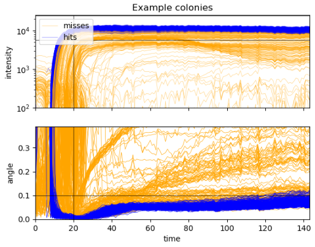

Time-Series Analysis
====================

Colony Differentiation supports the analysis of agar plates recorded at multiple time points. The ``Plate`` class loads RAW images, determines their acquisition times and estimates a background from recordings within a specified time interval.

Analysis Overview
-----------------

**Species-Based Colony Detection** identifies colonies matching a ``Species`` definition in a selected image.

**Time-Series Extraction** analyzes changes in colony intensity and color over time.

All recordings must show the same plate in a consistent position and orientation.

Example: RAW Image Series
-------------------------

Loading the Image Series
~~~~~~~~~~~~~~~~~~~~~~~~

Specify the folder containing the RAW images and initialize a ``Plate`` object.

.. code-block:: python

   import sys
   sys.path.insert(0, "../colony_differentiation")
   from tools import *

   image_folder = "path/to/your/image_series"

.. literalinclude:: examples/time_series_example.py
   :language: python
   :start-at: plate = Plate(
   :end-at: plate = Plate(

Recording times are determined from image metadata or filenames and expressed in hours relative to the first recording.

* ``number`` selects images belonging to a numbered plate, e.g. filenames starting with ``01_``.
* ``background_interval`` specifies the time interval used to estimate the background, preferably before substantial colony development.
* ``area_of_interest`` optionally restricts detection to a rectangular region specified as ``(x_min, x_max, y_min, y_max)``.

Selecting a Detection Time
~~~~~~~~~~~~~~~~~~~~~~~~~~

Choose a time at which the colonies are clearly visible. The first recording after the specified time is displayed.

.. literalinclude:: examples/time_series_example.py
   :language: python
   :start-at: detection_time =
   :end-at: plate.show(time=detection_time)

Species-Based Colony Detection
~~~~~~~~~~~~~~~~~~~~~~~~~~~~~~

As in :doc:`single_image`, species settings can be estimated from preliminary colonies or defined manually.

**Option A: Estimate Species Settings**

.. literalinclude:: examples/time_series_example.py
   :language: python
   :start-at: plate.find_candidates(
   :end-at: plate.find_candidates(

Inspect the preliminary colonies and exclude incorrect detections if necessary before estimating the species settings.

.. literalinclude:: examples/time_series_example.py
   :language: python
   :start-at: species = plate.candidates.get_species(
   :end-at: print(species)

**Option B: Define Species Settings Manually**

.. code-block:: python

   species = Species(
       name="Example colonies",
       vector=np.array([1.0, 1.0, 1.0]),
       weights=np.array([1.0, 2.0, 2.0]),
       radius=10,
       sigma=2,
       time=detection_time,
       intensity=1000,)

Detect the colonies using the selected species settings.

.. literalinclude:: examples/time_series_example.py
   :language: python
   :start-at: plate.find_colonies(species,
   :end-at: print("Detected colonies

Time-Series Extraction and Visualization
~~~~~~~~~~~~~~~~~~~~~~~~~~~~~~~~~~~~~~~~

Extract and plot intensity and color difference over time at the detected and potentially missed colony positions. The same positions are used in every recording.

.. literalinclude:: examples/time_series_example.py
   :language: python
   :start-at: plate.get_timeseries(
   :end-at: plt.show()

By default, all recordings are analyzed. Use ``step`` to skip images or ``t_max`` to restrict the analysis to a specified time in hours.

Example Output
--------------

The upper plot shows colony intensity and the lower plot shows color deviation (angle) over time. Blue lines represent detected colonies and orange lines represent potentially missed colonies. Black lines indicate the selected detection time and detection thresholds.

Common Problems and Solutions
-----------------------------

* **No images found:** Check the folder path, RAW file extensions and plate number.
* **Missing acquisition times:** Check image metadata or use filenames containing ``YYYY-MM-DD_HH-MM-SS``.
* **Invalid background interval or detection time:** Choose a background interval containing recordings and a detection time before the final recording.
* **No time-series plot:** Make sure at least one colony was detected and ``get_timeseries()`` was executed with at least one recording.
* **Inconsistent colony positions:** Ensure that the plate remains in the same position and orientation throughout the recordings.